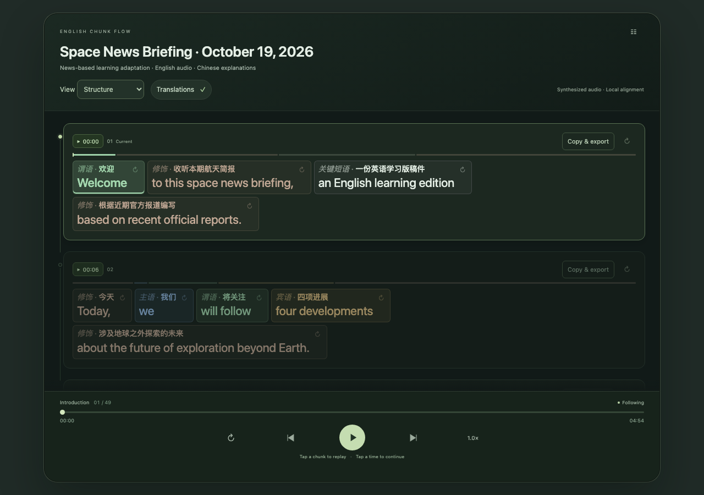

# English Chunk Flow · Agent Skill

**Una skill de código abierto para practicar inglés desde tu asistente de IA, probada en Codex de escritorio.**

Invoca `$english-chunk-flow` con material en inglés o un tema. El asistente prepara bloques gramaticales, traducciones y una lección reproducible. La skill es el punto de entrada; el reproductor es la interfaz de aprendizaje generada.

**Escucha las palabras. Comprende la estructura.**

[English / full technical guide](../../README.md) · [简体中文](README.zh-CN.md) · [日本語](README.ja.md) · [한국어](README.ko.md) · [العربية](README.ar.md) · [Español](README.es.md) · [Português](README.pt.md) · [Deutsch](README.de.md) · [Русский](README.ru.md)

English Chunk Flow es una habilidad de código abierto para practicar la comprensión oral del inglés mediante bloques gramaticales, colores y fondos anidados. Ayuda a identificar el sujeto, el predicado y las relaciones entre cláusulas cuando conocer las palabras no basta.



## Funciones

Desplazamiento continuo y repetición de bloques, grupos o frases. La marca de tiempo continúa el audio. Guarda con clic derecho, pulsación larga o Shift+F10; repasa en Lesson menu → Saved chunks. Explicaciones en español, chino, japonés, coreano, árabe, portugués, alemán, ruso o inglés. La interfaz es inglesa.

## Instalación

Necesitas un asistente con habilidades y herramientas locales, y Python 3.10+. La síntesis local usa say/afconvert de macOS; la alineación opcional usa PocketSphinx 5.1.1. El instalador usa ~/.agents/skills/english-chunk-flow y no sobrescribe una instalación existente.

```sh
git clone https://github.com/oeniao/english-chunk-flow.git
cd english-chunk-flow
python3 scripts/install.py
python3 ~/.agents/skills/english-chunk-flow/scripts/setup.py
python3 ~/.agents/skills/english-chunk-flow/scripts/run.py doctor
```

## Uso

> Use $english-chunk-flow to preserve my English article and explain every grammar chunk in Spanish.

```sh
python3 skills/english-chunk-flow/scripts/setup.py
python3 skills/english-chunk-flow/scripts/run.py build --source examples/workday/source.txt --annotation examples/workday/annotation.json --out output/workday --tts say
python3 skills/english-chunk-flow/scripts/run.py serve --root output/workday --port 8770
```

[http://127.0.0.1:8770/index.html](http://127.0.0.1:8770/index.html) · `output/workday/lesson.html`

## Entradas y límites

Admite texto, HTML, DOCX, SRT/VTT, audio original con transcripción revisada y material temático escrito por el asistente. El asistente analiza y traduce; la CLI valida y empaqueta. No es un analizador autónomo. No incluye transcripción de audio solo, extracción automática de YouTube, OCR, API de voz prémium ni cambio de idioma durante la reproducción. Los tiempos son estimaciones y hay que revisar gramática y traducciones. No se ha demostrado la eficacia pedagógica.

## Privacidad y código abierto

Los archivos se procesan localmente; el modelo del asistente puede usar la nube según su configuración. No publiques grabaciones privadas, historial ni claves. Licencia MIT; las dependencias conservan sus licencias. Se agradecen mejoras de traducción, gramática, reproducción y accesibilidad.

[MIT](../../LICENSE) · [Contributing](../../CONTRIBUTING.md) · [Privacy](../../SECURITY.md) · [Architecture](../ARCHITECTURE.md) · [Testing](../TESTING.md) · [Third-party notices](../../THIRD_PARTY_NOTICES.md)
