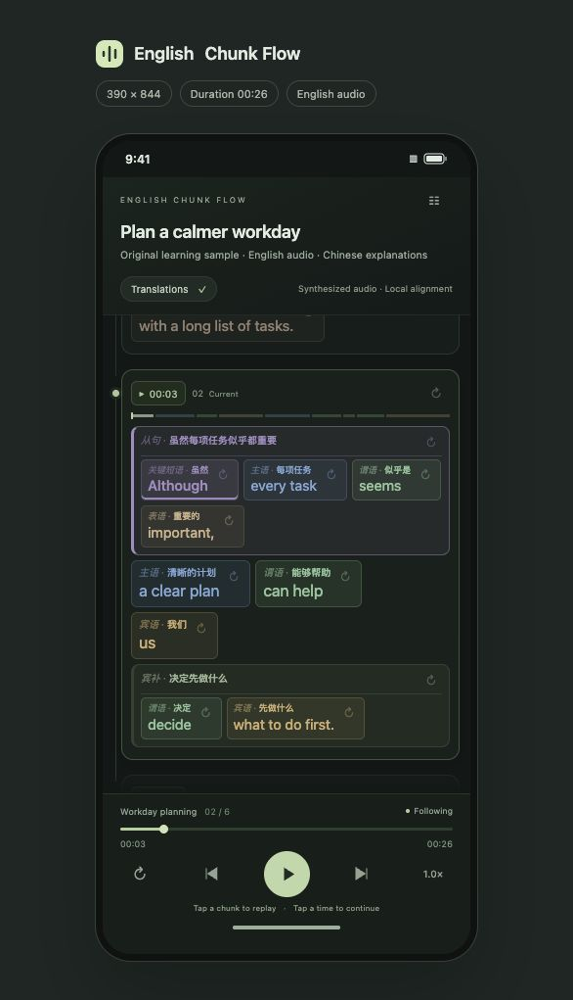

# English Chunk Flow

**단어를 듣고, 문장의 구조를 이해하세요.**

[English / full technical guide](../../README.md) · [简体中文](README.zh-CN.md) · [日本語](README.ja.md) · [한국어](README.ko.md) · [العربية](README.ar.md) · [Español](README.es.md) · [Português](README.pt.md) · [Deutsch](README.de.md) · [Русский](README.ru.md)

English Chunk Flow는 영어 문장을 문법 청크로 나누고 색상과 중첩 배경으로 주어, 서술어, 절, 수식 관계를 보여 주는 오픈 소스 듣기 스킬입니다. 단어는 알지만 문장 전체를 따라가기 어려운 학습자를 돕습니다.



## 기능

연속 스크롤, 청크·상위 블록·문장 다시 듣기, 타임스탬프부터 이어 듣기를 지원합니다. 오른쪽 클릭, 길게 누르기 또는 Shift+F10으로 저장하고 Lesson menu → Saved chunks에서 복습합니다. 한·중·일·아랍·스페인·포르투갈·독일·러시아어 및 영어 해설을 지원하며 제품 UI는 영어입니다.

## 설치

스킬과 로컬 도구를 지원하는 호스트 도우미 및 Python 3.10+가 필요합니다. 로컬 음성 합성은 macOS say/afconvert, 정렬은 선택 설치하는 PocketSphinx 5.1.1을 사용합니다. 기본 경로는 ~/.agents/skills/english-chunk-flow이며 기존 폴더를 덮어쓰지 않습니다.

```sh
git clone https://github.com/oeniao/english-chunk-flow.git
cd english-chunk-flow
python3 scripts/install.py
python3 ~/.agents/skills/english-chunk-flow/scripts/setup.py
python3 ~/.agents/skills/english-chunk-flow/scripts/run.py doctor
```

## 사용법

> Use $english-chunk-flow to keep my English text and explain every grammar chunk in Korean.

```sh
python3 skills/english-chunk-flow/scripts/setup.py
python3 skills/english-chunk-flow/scripts/run.py build --source examples/workday/source.txt --annotation examples/workday/annotation.json --out output/workday --tts say
python3 skills/english-chunk-flow/scripts/run.py serve --root output/workday --port 8770
```

[http://127.0.0.1:8770/index.html](http://127.0.0.1:8770/index.html) · `output/workday/lesson.html`

## 입력과 제한

텍스트, HTML, DOCX, SRT/VTT, 원본 음성＋검토된 대본, 도우미가 작성한 주제별 자료를 지원합니다. 언어 분석·번역은 도우미가 담당하고 CLI는 검증·패키징을 수행합니다. 독립형 자동 파서가 아닙니다. 음성만으로 전사하기, YouTube 자동 추출, OCR, 유료 음성 API, 재생 중 해설 언어 전환은 미구현입니다. 시간 경계는 추정이며 문법·번역 검토가 필요합니다. 학습 효과가 인증된 제품은 아닙니다.

## 개인정보와 오픈 소스

파일은 로컬에서 처리하지만 호스트 모델까지 오프라인이라는 뜻은 아닙니다. 개인 녹음·기록·키를 공개하지 마세요. MIT 라이선스이며 의존성은 자체 라이선스를 유지합니다. 번역·문법·재생·접근성 개선을 환영합니다.

[MIT](../../LICENSE) · [Contributing](../../CONTRIBUTING.md) · [Privacy](../../SECURITY.md) · [Architecture](../ARCHITECTURE.md) · [Testing](../TESTING.md) · [Third-party notices](../../THIRD_PARTY_NOTICES.md)
